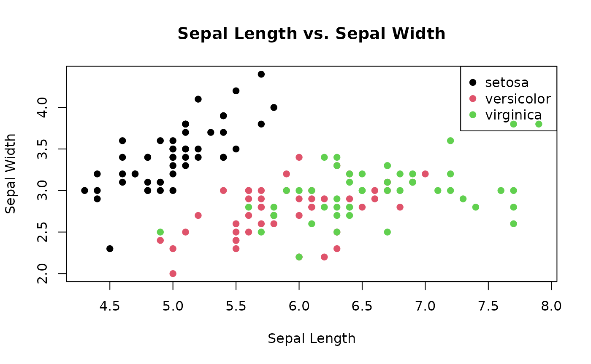
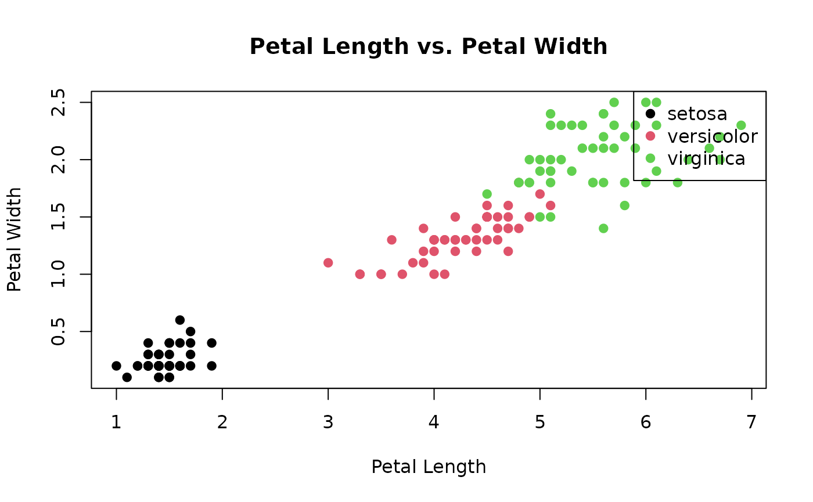

# Using FuzzyClass: Solving a Classification Problem

In this vignette, we will explore how to utilize the `FuzzyClass`
package to solve a classification problem. The problem at hand involves
classifying different types of iris flowers based on their petal and
sepal characteristics. The `iris` dataset, commonly available in R, will
be used for this purpose.

## Exploratory Data Analysis of the Iris Dataset

In this vignette, we will perform an exploratory data analysis (EDA) of
the classic `iris` dataset. This dataset consists of measurements of
sepal length, sepal width, petal length, and petal width for three
species of iris flowers. We will use various visualizations and summary
statistics to gain insights into the data.

### Loading the Data

Let’s start by loading the `iris` dataset and examining its structure:

``` r

# Load the iris dataset
data(iris)

# Display the structure of the dataset
str(iris)
#> 'data.frame':    150 obs. of  5 variables:
#>  $ Sepal.Length: num  5.1 4.9 4.7 4.6 5 5.4 4.6 5 4.4 4.9 ...
#>  $ Sepal.Width : num  3.5 3 3.2 3.1 3.6 3.9 3.4 3.4 2.9 3.1 ...
#>  $ Petal.Length: num  1.4 1.4 1.3 1.5 1.4 1.7 1.4 1.5 1.4 1.5 ...
#>  $ Petal.Width : num  0.2 0.2 0.2 0.2 0.2 0.4 0.3 0.2 0.2 0.1 ...
#>  $ Species     : Factor w/ 3 levels "setosa","versicolor",..: 1 1 1 1 1 1 1 1 1 1 ...
```

The output provides a summary of the dataset’s structure:

- The dataset is a data.frame with 150 observations (rows) and 5
  variables (columns).
- Each variable is listed with its name and data type (num for numeric
  and Factor for categorical).
- For numeric variables (Sepal.Length, Sepal.Width, Petal.Length,
  Petal.Width), summary statistics like the mean, median, and quartiles
  might be shown.
- The Species variable is a categorical factor with 3 levels: “setosa”,
  “versicolor”, and “virginica”.
- This summary gives an overview of the dataset’s dimensions, variable
  types, and some basic statistics, helping users understand the
  dataset’s content before diving into further analysis.

### Summary Statistics

Next, let’s calculate summary statistics for each species:

``` r

# Calculate summary statistics by species
summary_by_species <- by(iris[, -5], iris$Species, summary)
summary_by_species
#> iris$Species: setosa
#>   Sepal.Length    Sepal.Width     Petal.Length    Petal.Width   
#>  Min.   :4.300   Min.   :2.300   Min.   :1.000   Min.   :0.100  
#>  1st Qu.:4.800   1st Qu.:3.200   1st Qu.:1.400   1st Qu.:0.200  
#>  Median :5.000   Median :3.400   Median :1.500   Median :0.200  
#>  Mean   :5.006   Mean   :3.428   Mean   :1.462   Mean   :0.246  
#>  3rd Qu.:5.200   3rd Qu.:3.675   3rd Qu.:1.575   3rd Qu.:0.300  
#>  Max.   :5.800   Max.   :4.400   Max.   :1.900   Max.   :0.600  
#> ------------------------------------------------------------ 
#> iris$Species: versicolor
#>   Sepal.Length    Sepal.Width     Petal.Length   Petal.Width   
#>  Min.   :4.900   Min.   :2.000   Min.   :3.00   Min.   :1.000  
#>  1st Qu.:5.600   1st Qu.:2.525   1st Qu.:4.00   1st Qu.:1.200  
#>  Median :5.900   Median :2.800   Median :4.35   Median :1.300  
#>  Mean   :5.936   Mean   :2.770   Mean   :4.26   Mean   :1.326  
#>  3rd Qu.:6.300   3rd Qu.:3.000   3rd Qu.:4.60   3rd Qu.:1.500  
#>  Max.   :7.000   Max.   :3.400   Max.   :5.10   Max.   :1.800  
#> ------------------------------------------------------------ 
#> iris$Species: virginica
#>   Sepal.Length    Sepal.Width     Petal.Length    Petal.Width   
#>  Min.   :4.900   Min.   :2.200   Min.   :4.500   Min.   :1.400  
#>  1st Qu.:6.225   1st Qu.:2.800   1st Qu.:5.100   1st Qu.:1.800  
#>  Median :6.500   Median :3.000   Median :5.550   Median :2.000  
#>  Mean   :6.588   Mean   :2.974   Mean   :5.552   Mean   :2.026  
#>  3rd Qu.:6.900   3rd Qu.:3.175   3rd Qu.:5.875   3rd Qu.:2.300  
#>  Max.   :7.900   Max.   :3.800   Max.   :6.900   Max.   :2.500
```

The output provides summary statistics for each numeric attribute within
each species of iris flowers. For each species, statistics such as
minimum, maximum, mean, median, and quartiles are presented for each
attribute. This information gives insight into the distribution and
variation of attributes across different species, aiding in
understanding the characteristics of each iris species.

### Data Visualization

#### Sepal Length vs. Sepal Width

We’ll create a scatter plot to visualize the relationship between sepal
length and sepal width:

``` r

# Scatter plot of sepal length vs. sepal width
plot(iris$Sepal.Length, iris$Sepal.Width, col = iris$Species, pch = 19,
     xlab = "Sepal Length", ylab = "Sepal Width", main = "Sepal Length vs. Sepal Width")
legend("topright", legend = levels(iris$Species), col = 1:3, pch = 19)
```



#### Petal Length vs. Petal Width

Similarly, let’s visualize the relationship between petal length and
petal width:

``` r

# Scatter plot of petal length vs. petal width
plot(iris$Petal.Length, iris$Petal.Width, col = iris$Species, pch = 19,
     xlab = "Petal Length", ylab = "Petal Width", main = "Petal Length vs. Petal Width")
legend("topright", legend = levels(iris$Species), col = 1:3, pch = 19)
```



------------------------------------------------------------------------

## The Classification Problem

The classification problem revolves around categorizing iris flowers
into three species: setosa, versicolor, and virginica. These species are
defined based on their physical attributes, specifically the length and
width of their petals and sepals. Our goal is to create a classifier
that can predict the species of an iris flower given its petal and sepal
measurements.

## Solving the Problem with FuzzyClass

To solve this classification problem, we will use the `FuzzyClass`
package, which offers tools for building probabilistic classifiers. The
package leverages fuzzy logic to handle uncertainties and variations in
the data.

Let’s start by loading the required libraries and preparing the data:

``` r

library(FuzzyClass)

# Load the iris dataset
data(iris)

# Splitting the dataset into training and testing sets
set.seed(123)
train_index <- sample(nrow(iris), nrow(iris) * 0.7)
train_data <- iris[train_index, ]
test_data <- iris[-train_index, ]
```

Next, we will use the Fuzzy Gaussian Naive Bayes algorithm to build the
classifier:

``` r


# Build the Fuzzy Gaussian Naive Bayes classifier
fit_FGNB <- GauNBFuzzyParam(train = train_data[, -5],
                            cl = train_data[, 5], metd = 2, cores = 1)
```

Now that the classifier is trained, we can evaluate its performance on
the testing data:

``` r


# Make predictions on the testing data
predictions <- predict(fit_FGNB, test_data[, -5])

head(predictions)
#> [1] setosa setosa setosa setosa setosa setosa
#> Levels: setosa versicolor virginica

# Calculate the accuracy
correct_predictions <- sum(predictions == test_data[, 5])
total_predictions <- nrow(test_data)
accuracy <- correct_predictions / total_predictions

accuracy
#> [1] 0.9777778
```

The resulting accuracy gives us an indication of how well our classifier
performs on unseen data.

In conclusion, the `FuzzyClass` package provides a powerful toolset for
solving classification problems with fuzzy logic. By leveraging
probabilistic classifiers like the Fuzzy Gaussian Naive Bayes, we can
effectively handle uncertainties and make accurate predictions based on
intricate data patterns.
